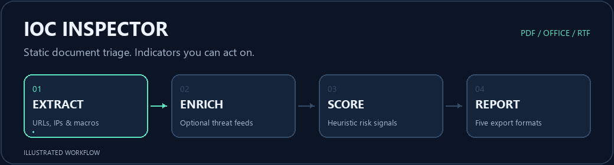
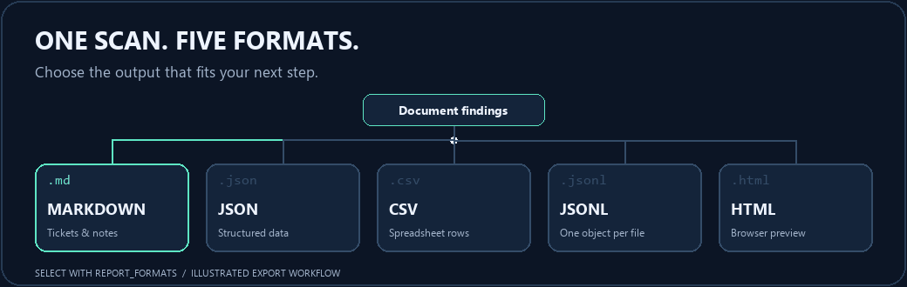
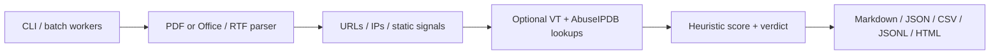

# IOC Inspector

[](https://github.com/PKHarsimran/IOC-Inspector/actions/workflows/ci.yml)
[](https://github.com/PKHarsimran/IOC-Inspector/actions/workflows/lint.yml)
[](https://codecov.io/gh/PKHarsimran/IOC-Inspector)
[](LICENSE)


**Suspicious document in. Actionable indicators out.**

IOC Inspector is a Python CLI for static PDF and Office document triage. Extract URLs and IPv4 addresses, inspect VBA behavior, optionally enrich indicators with VirusTotal and AbuseIPDB, and export findings for further investigation.

[Quick start](#quick-start) · [Usage](#usage) · [Reports](#reports-and-risk-scores) · [Configuration](#configuration) · [Development](#development)



[Static workflow](docs/assets/workflow.png). All animations on this page play once and stop; each has a static alternative.

**Start locally:** scan without API keys, follow terminal progress, and choose from five report formats. Use the interactive menu or pass options directly.

## What it scans

| Input | Analysis |
| --- | --- |
| PDF | Visible text, hyperlink targets, embedded-file count, JavaScript actions |
| DOCX / DOCM / XLSX / XLSM | XML text, relationship targets, VBA macros when present |
| DOC / XLS | VBA macro analysis and indicators found in macro code |
| RTF | Plaintext URLs and IPv4 addresses |

VBA analysis looks for auto-execution triggers, suspicious calls, long Base64-like strings, and payload-download patterns. Reports support **Markdown, JSON, CSV, JSONL, and HTML**.

<details>
<summary>Analysis scope and limitations</summary>

This is a static triage tool. It does not execute documents, OCR image-only pages, fully decode RTF content, or recursively inspect embedded payloads. A low score means few configured signals were found; it does not establish that a document is safe.

</details>

## Quick start

```bash
git clone https://github.com/PKHarsimran/IOC-Inspector.git
cd IOC-Inspector
python -m venv .venv
```

Activate your environment:

| Shell | Command |
| --- | --- |
| Windows PowerShell | `.\.venv\Scripts\Activate.ps1` |
| Windows Command Prompt | `.venv\Scripts\activate.bat` |
| Linux / macOS | `source .venv/bin/activate` |

Install the project and run the included benign PDF sample:

```bash
python -m pip install -e .
ioc-inspector --file examples/test.pdf --report
```

Prefer a guided setup? Run `ioc-inspector --interactive` to choose a file or folder, report formats, output directory, worker count, document types, file-size limit, offline mode, and a combined batch report.

You can also run from source with `python main.py --file examples/test.pdf`.

Markdown and JSON reports are written to `reports/` in your working directory by default. Logs go to `logs/`.

### See a scan


[Static scan example](docs/assets/terminal-demo.png). Illustrated using the included benign PDF; routine log lines are omitted.

```text
examples/test.pdf: score=0  verdict=benign
```

<details>
<summary>Optional reputation enrichment</summary>

Copy `.env.example` to `.env` in the project root:

```powershell
# PowerShell
Copy-Item .env.example .env
```

```bash
# Linux / macOS
cp .env.example .env
```

Add your own keys:

```dotenv
VT_API_KEY=
ABUSEIPDB_API_KEY=
```

With keys configured, extracted URLs are sent to VirusTotal for existing reputation reports and extracted IPs are sent to AbuseIPDB. Original documents are not uploaded. Without a key, its service is skipped. Failed or missing lookups contribute no reputation points.

Use `--offline` to skip both services even when keys are configured. Reports record service and indicator statuses: `success`, `failed`, `skipped`, or `not_found`; a service with mixed outcomes is `partial`. Skip reasons distinguish offline mode, missing API keys, and documents with no applicable indicators. HTTP failures and invalid responses are recorded explicitly.

Requests are cached within the process and paced across scan threads. Separate CLI processes have separate caches and rate limiters.

</details>

## Usage

```bash
# Choose settings through the interactive menu
ioc-inspector --interactive

# Scan one document
ioc-inspector --file invoice.docx

# Scan several documents
ioc-inspector --file invoice.docx --file attachment.pdf

# Scan a directory recursively with four worker threads
ioc-inspector --dir samples/ --threads 4

# Scan selected document types within a 20 MiB input-size limit
ioc-inspector --dir samples/ --extensions pdf,docx --max-size-mb 20

# Choose report formats and output location; include a combined JSON report
ioc-inspector --dir samples/ --format json --format html --output-dir results/ --batch-report

# Guarantee local-only analysis even when API keys are configured
ioc-inspector --file attachment.pdf --offline

# Combine an explicit file and a directory (duplicates are scanned once)
ioc-inspector --file invoice.docx --dir samples/

# Suppress console summaries; errors still print
ioc-inspector --dir samples/ --quiet

# Troubleshoot or inspect all available options
ioc-inspector --file attachment.pdf --debug
ioc-inspector --help
```

| Option | Behavior |
| --- | --- |
| `-f`, `--file PATH` | Scan an existing file; repeat for multiple files |
| `-d`, `--dir PATH` | Recursively scan existing files in a directory |
| `--interactive` | Choose scan settings through prompts; cannot be combined with `--quiet` |
| `-t`, `--threads 1..32` | Number of worker threads; default `1` |
| `--extensions pdf,docx` | Restrict input types; extensions are case insensitive and the leading dot is optional |
| `--max-size-mb N` | Maximum input size in MiB; default `50`, or `0` for unlimited |
| `--format FORMAT` | Replace configured report formats; repeat to select several |
| `--output-dir PATH` | Write reports here instead of `REPORTS_DIR` |
| `--batch-report` | Also write `batch_summary.json` with all results, skips, and errors |
| `--offline` | Skip both reputation services regardless of configured keys |
| `--report` | Add Markdown to the configured report formats |
| `--json` | Add JSON to the configured report formats |
| `--quiet` | Suppress progress, summaries, and informational console logs |
| `--no-progress` | Hide the spinner and progress bar while keeping results and summaries |
| `--debug` | Enable debug logging across analysis modules |
| `--version` | Print the installed package version |

Directory scans select supported document types and skip generated reports, output/log folders, virtual environments, repository metadata, and symlinked directories. An explicitly supplied unsupported file can still receive an `unknown` verdict. The optional extension filter and size limit apply to explicit files too. A file included more than once is scanned once. Documents with the same filename stem receive a path-based suffix during a batch, preserving separate reports.

Interactive terminals show a spinner and progress bar, colored verdicts, and a final count of scanned, failed, and skipped items. Redirected output stays plain. Set `NO_COLOR` to disable verdict colors, or use `--no-progress` to hide the animation. Quiet mode keeps errors visible.

**Exit codes:** `0` when no document is classified malicious and no processing fails; `1` if any document is malicious or file selection, analysis, or report writing fails; `2` for invalid CLI usage or no matching documents after filtering. A suspicious or unknown verdict can return `0`, so inspect the verdict in automated workflows. Processing continues after individual file failures. Reputation-service failures are recorded in reports and do not by themselves change the exit code.

## Reports and risk scores



[Static export workflow](docs/assets/report-formats.png).

| Format | Useful for | Output per document |
| --- | --- | --- |
| Markdown | Investigation notes and tickets | A readable report with IOC tables |
| JSON | Scripts and integrations | A structured findings object |
| CSV | Spreadsheet review | `field,value` rows |
| JSONL | Line-oriented processing | One JSON object in each document's report file |
| HTML | Browser viewing | Escaped report text |

Enable all five formats in `.env`:

```dotenv
REPORT_FORMATS=markdown,json,csv,jsonl,html
```

Set `REPORT_FORMATS=` to disable default report writing; `--report` and `--json` can still request their respective formats.

For a single manifest of the run, add `--batch-report`. The resulting `batch_summary.json` contains:

- UTC start time, elapsed time, and offline-mode setting.
- Counts by verdict, plus scanned, errored, and skipped item totals.
- Each source path, its full findings or error, and any generated report paths.
- Skip reasons for filtered, oversized, unsupported, and generated files. An excluded directory is recorded once as a skipped item.

The manifest is written even when no documents match or individual files fail. Results keep their input order regardless of thread completion order. Batch report writing failures return exit code `1`.

| Score | Verdict |
| --- | --- |
| `0–29` | Benign |
| `30–69` | Suspicious |
| `70–100` | Malicious |

Scoring weights live in [`settings.py`](settings.py), and scores are capped at `100`. These are heuristic verdicts, not detection guarantees.

## Configuration

Set environment variables or edit the project-root `.env`. Existing environment variables take precedence.

| Setting | Default | Purpose |
| --- | --- | --- |
| `VT_API_KEY` | Empty | Optional VirusTotal key |
| `ABUSEIPDB_API_KEY` | Empty | Optional AbuseIPDB key |
| `VT_THRESHOLD` | `5` | Malicious vendors needed for URL reputation points |
| `ABUSE_CONFIDENCE_CUTOFF` | `70` | AbuseIPDB confidence needed for IP reputation points |
| `REPORT_FORMATS` | `markdown,json` | Comma-separated formats; whitespace and case are normalized |
| `REPORTS_DIR` | `reports` | Output directory, relative to the working directory unless absolute |
| `LOG_DIR` | `logs` | Log directory, relative to the working directory unless absolute |
| `LOG_LEVEL` | `INFO` | Default logging level |
| `LOG_MAX_BYTES` | `2000000` | Rotating log file size |
| `LOG_BACKUP_COUNT` | `3` | Number of rotated log backups |

## How it works



| Location | Purpose |
| --- | --- |
| `main.py` | CLI, terminal progress, concurrent scanning, report selection, exit codes |
| `ioc_inspector_core/` | Parsers, IOC extraction, enrichment, scoring, reporting |
| `ioc_inspector_core/cli_support.py` | Interactive prompts, document filtering, batch counts |
| `settings.py`, `.env.example` | Configuration and example environment |
| `examples/` | Included document fixtures |
| `tests/` | Offline unit and smoke tests |
| `tools/render_readme_animation.py` | Rebuild all three animations and their static PNG alternatives |

## Development

```bash
python -m pip install -e . -r dev-requirements.txt
python -m pytest
ruff check .
mypy ioc_inspector_core main.py logger.py settings.py
```

Tests mock HTTP calls, clear reputation caches, and disable pacing delays. CI tests Python **3.10 and 3.11** on Linux and Windows, with an **80% minimum core coverage** gate. See [`UnitTestingGuide.md`](UnitTestingGuide.md) for background.

<details>
<summary>Regenerate the README animations</summary>

```bash
python -m pip install Pillow
python tools/render_readme_animation.py
```

This rebuilds the workflow, CLI demo, and report-format graphics in `docs/assets/`. Pillow is only needed to generate artwork.

</details>

## Next improvements

- Expand RTF and legacy Office content extraction.
- Add bounded processing for very large or deeply nested documents.
- Add distribution builds and release automation.

Found a bug or have a feature request? [Open an issue](https://github.com/PKHarsimran/IOC-Inspector/issues). For vulnerabilities, follow the [security policy](SECURITY.md).

Licensed under the [MIT License](LICENSE).
